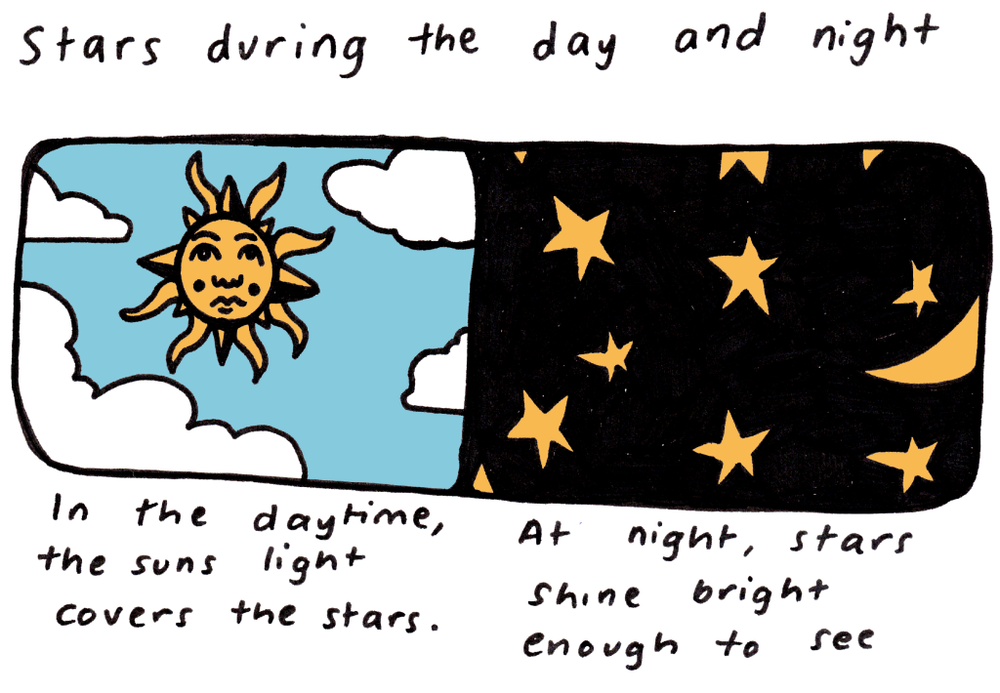
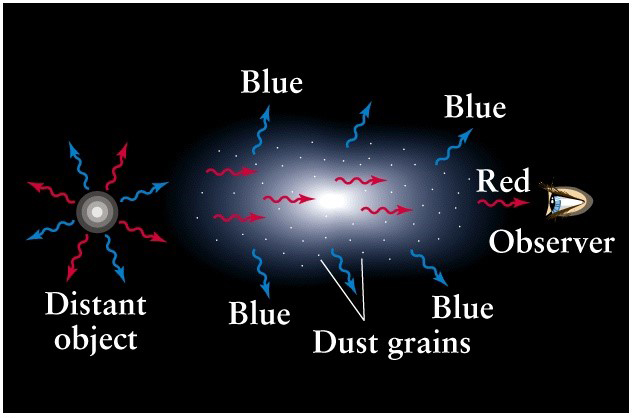

## Episode 1: Light as the Messenger

In this episode, we explore one of the most fascinating phenomena in physics: light.

### Key Topics

- Wave-particle duality
- also other stuff
- The speed of light
- Photons and energy
- How light carries information

Light is all around us. From the moment we open our eyes, we are receiving information transmitted by light traveling from distant sources.

### What do we see in the sky?

When we look in the sky, we see several objects. The brightest is the sun. We can sometimes see the moon, and in the night, when the sky is clear we can see some planets and dozens of stars.

<!-- -->

### What does it mean to see something

To see something means that light is emitted from that object travels through space and reaches our eyes.

But was exactly is light?

Generally speaking, it is a form of energy, that can propagate through space (even through empty space = vacuum).

More concretely it is a type of electromagnetic radiation, a form of electromagnetic field that propagates in the form of a wave. Both the electromagnetic field and electromagnetic waves interact in a very specific way with electrically charged matter, including particles such as electrons, protons (but not neutrons).

### Analogy: water surface waves

Waves are common in nature and have universal features. Let us for a moment focus on a more familiar example, water surface waves. Here you can see a pair of ducks perturbing the water, then these perturbations propagate outwards as waves

### What Makes Light Special?

Light is unique because it always travels at the same speed in a vacuum, regardless of the observer's frame of reference. This constancy led Einstein to develop the theory of special relativity.

More detailed content coming soon...
